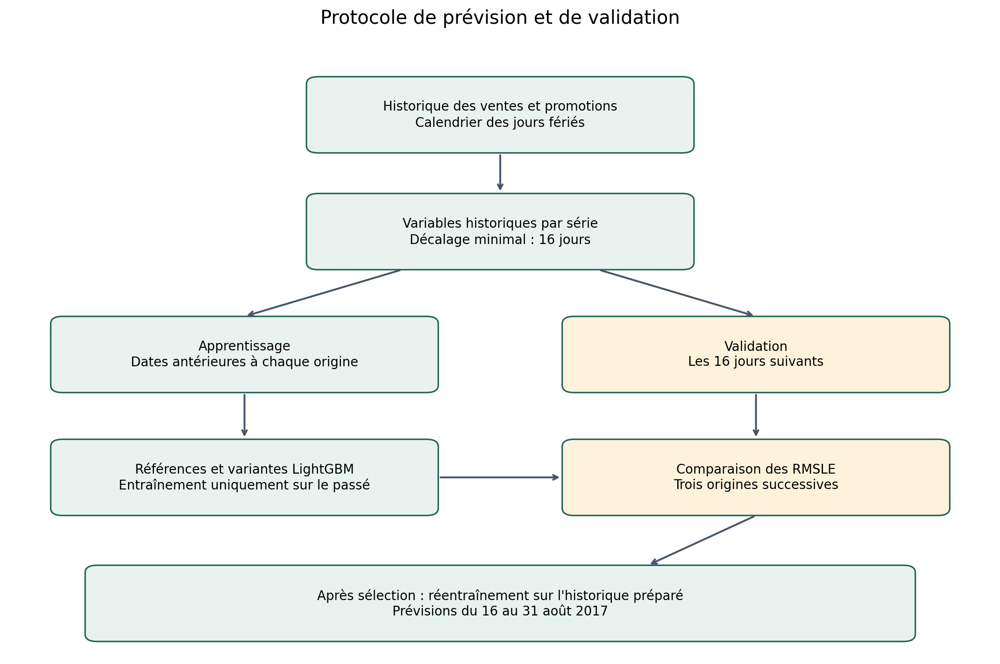
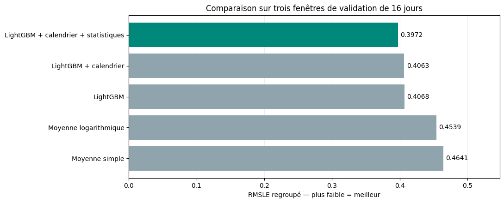
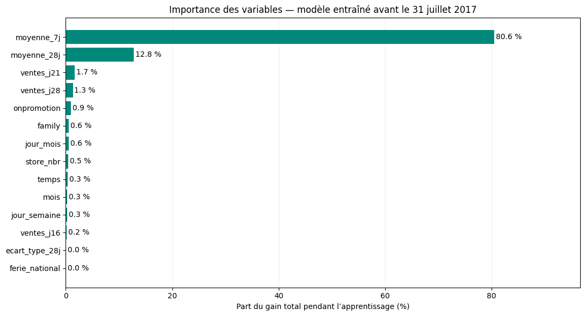

# Store Sales — Prévision des ventes à 16 jours

Projet personnel de data science réalisé par **Abdelmoughit Douimia** avec **Python, pandas et LightGBM** pour prévoir les quantités vendues par magasin et famille de produits.

**Score officiel Kaggle : 0,43477 RMSLE** · **Validation interne : 0,3972 RMSLE** · **Horizon : 16 jours**

L’objectif est d’illustrer une démarche de prévision pouvant aider à planifier les approvisionnements : explorer les données, construire des variables disponibles au moment de la prévision, comparer des références et analyser les erreurs. Aucun gain financier ou opérationnel n’a été mesuré.

## Données et périmètre

- **Source :** [Kaggle — Store Sales: Time Series Forecasting](https://www.kaggle.com/competitions/store-sales-time-series-forecasting/data).
- **Exploration :** 3 000 888 observations, du 1er janvier 2013 au 15 août 2017.
- **Structure :** 54 magasins × 33 familles = 1 782 séries quotidiennes.
- **Apprentissage :** historique préparé depuis le 31 juillet 2016 ; 677 160 lignes lors du réentraînement final jusqu’au 15 août 2017. L’exploration porte sur un historique plus long que l’entraînement.
- **Cible :** quantités vendues, parfois fractionnaires, et non chiffre d’affaires.
- **Qualité :** aucun doublon de clé ni valeur manquante dans les colonnes principales du fichier fourni ; quatre dates absentes, correspondant aux 25 décembre 2013 à 2016. Ces absences ne sont pas remplacées par des ventes nulles.

## Méthode



Deux références calculent la moyenne arithmétique ou logarithmique des huit semaines précédentes, par magasin, famille et jour de semaine. Elles sont comparées à trois variantes LightGBM : initiale, avec calendrier national, puis avec statistiques historiques.

Le modèle utilise les promotions fournies, les catégories magasin/famille, le calendrier, les ventes décalées de 16, 21 et 28 jours, ainsi que des moyennes sur 7 et 28 jours et un écart-type sur 28 jours. Les statistiques sont calculées sur une grille quotidienne après un décalage de 16 jours. Pour une cible J, la moyenne sur 7 jours utilise J−22 à J−16 : aucune vente de la fenêtre à prévoir n’est nécessaire.

LightGBM apprend `log1p(sales)` ; les prédictions sont reconverties avec `expm1` puis limitées à zéro au minimum. Les identifiants sont catégoriels. Les jours fériés nationaux transférés sont pris à leur date effective ; les événements imprévus, les jours locaux/régionaux, les transactions et les prix du pétrole ne sont pas utilisés comme variables.

## Résultat officiel Kaggle

Une soumission du projet à la compétition **Store Sales – Time Series Forecasting** a été acceptée le **21 novembre 2026**, avec un **RMSLE de 0,43477** sur le jeu de test de la compétition, du **16 au 31 août 2017**. Le résultat a été constaté sur la page Kaggle de soumissions, avec le statut **Complete**. Le score est conservé dans [results/kaggle_submission.json](results/kaggle_submission.json). Aucun rang ni percentile n’est revendiqué.

Le score officiel et les scores de validation ci-dessous portent sur des périodes différentes ; ils sont présentés séparément.

## Résultats de validation interne

Trois fenêtres successives de **16 jours** : 29 juin–14 juillet, 15–30 juillet et 31 juillet–15 août 2017. Chaque modèle apprend uniquement sur les dates antérieures à sa fenêtre. Total : **85 536 prévisions**.

| Méthode | RMSLE regroupé ↓ |
|---|---:|
| Moyenne arithmétique saisonnière | 0,4641 |
| Moyenne logarithmique saisonnière | 0,4539 |
| LightGBM initial | 0,4068 |
| LightGBM + calendrier national | 0,4063 |
| **LightGBM + calendrier + statistiques** | **0,3972** |

Le modèle retenu réduit le RMSLE d’environ **12,5 %** face à la référence logarithmique et **2,2 %** face à la variante avec calendrier. Il est meilleur sur chacune des trois fenêtres : 0,3859 ; 0,3954 ; 0,4100. Le regroupement utilise la racine de la moyenne des RMSLE au carré, pondérée par le nombre de lignes.





Les moyennes sur 7 et 28 jours dominent les gains des coupures dans le modèle de la dernière fenêtre. Cette importance d’apprentissage n’établit pas de causalité et peut être répartie entre variables corrélées. Les courbes du magasin 1 et le diagnostic « 24 familles sur 33 » du notebook concernent les variantes initiales, clairement identifiées.

## Reproduire le projet

### Dans Kaggle

1. Importer [le notebook](notebooks/store_sales_forecasting.ipynb).
2. Ajouter les données **Store Sales – Time Series Forecasting** avec **Add Input**. L’import `.ipynb` seul ne les joint pas.
3. Lancer **Save Version → Save & Run All**.
4. Récupérer `/kaggle/working/submission_amelioree.csv`, les tableaux et `versions_execution.json`. Les figures sont enregistrées dans `/kaggle/working/figures/`.

Le fichier `submission.csv` correspond à la première variante ; **`submission_amelioree.csv`** correspond au modèle retenu. Les deux prévoient les 28 512 lignes du 16 au 31 août 2017. Les CSV complets de soumission ne sont pas inclus dans ce dépôt : ils sont générés par le notebook.

### En local

Depuis la racine du projet, utiliser un environnement Python avec Jupyter :

```bash
python -m venv .venv
source .venv/bin/activate
python -m pip install -r requirements.txt
jupyter lab
```

Placer `train.csv`, `test.csv`, `sample_submission.csv`, `holidays_events.csv` et `stores.csv` dans `data/`. Un autre emplacement peut être indiqué avec la variable d’environnement `STORE_SALES_DATA_DIR`. Ouvrir le notebook et exécuter les cellules dans l’ordre. Les exports locaux sont placés dans `outputs/`.

Les dépendances sont données sous forme de plages de versions, sans prétendre verrouiller l’environnement Kaggle original. Une cellule enregistre les versions réellement utilisées lors de chaque exécution. Les variations de bibliothèques peuvent entraîner de petites différences numériques.

Pour lancer les contrôles ciblés de disponibilité temporelle, qui ne nécessitent pas les CSV :

```bash
python -m unittest discover -s tests -v
```

## Limites et état de vérification

Les fenêtres de l’été 2017 ont servi à choisir les variables et à examiner les erreurs. **0,3972 est un score de validation de développement**, pas une mesure sur un test final indépendant, ni un score officiel Kaggle. Une période encore non consultée et d’autres saisons permettraient d’élargir l’évaluation. Les promotions futures sont supposées connues à l’origine ; en production, elles devraient provenir d’un planning disponible à cette date.

Les résultats et les sept graphiques de données proviennent du notebook Kaggle de l’auteur. Les CSV de validation dans `results/` reproduisent les valeurs affichées, arrondies à quatre décimales. Le **21 novembre 2026**, l’auteur a confirmé une exécution complète sur Kaggle en **183,1 secondes**, sans accélérateur, puis une soumission acceptée avec le score officiel indiqué ci-dessus.

Le notebook publié ajoute de la documentation, des contrôles et des chemins compatibles avec une exécution locale. Ses cellules de code sont compilées et six tests ciblés sur données synthétiques vérifient la construction temporelle. Ces contrôles locaux n’ont pas réentraîné les modèles sur les données réelles et ne remplacent pas une reproduction complète avec les CSV de la compétition.

Voir [les vérifications méthodologiques](docs/verification.md) et [la formulation pour le CV](docs/cv.md).

## Structure du dépôt

```text
notebooks/     Notebook principal avec analyse, modèles et sorties
figures/       Graphiques et schéma du protocole
results/       Scores de validation et résultat officiel Kaggle
tests/         Contrôles de disponibilité temporelle
data/          Instructions pour obtenir les données
docs/          Vérifications et présentation du projet
```

## Source des données

Alexis Cook, DanB, inversion et Ryan Holbrook. *Store Sales – Time Series Forecasting*. Kaggle, 2021. [Page de la compétition](https://www.kaggle.com/competitions/store-sales-time-series-forecasting). Les fichiers de données restent soumis aux conditions de la compétition.
